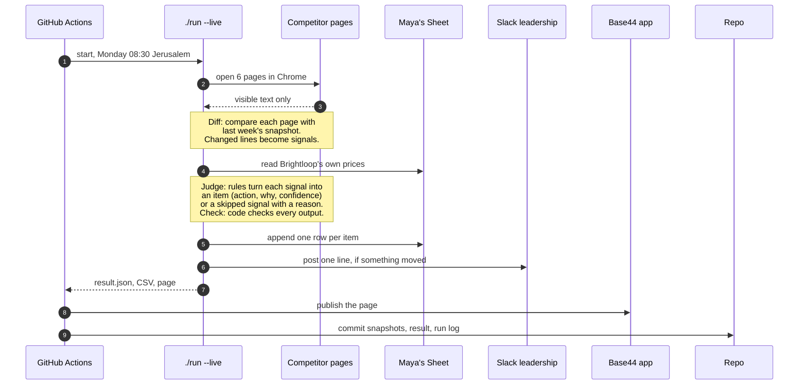

# Brightloop pricing watch

Every Monday before her 11:00 leadership meeting, Maya (Head of Growth at Brightloop) gets each change on Lovable's, Replit's and Bolt's pricing pages, judged the way she judges it, as rows in her Google Sheet and one line in Slack.

| | |
|---|---|
| Try it, zero keys | `./run --input cases.json --output result.json` |
| Prove it | `npm ci && npm test` |
| Live page | **https://brightloop-pricing-watch-11e53ec8.base44.app** (public, no login) |
| Maya's Sheet | **https://docs.google.com/spreadsheets/d/1HXgiG-YdpvyPeCEomQ_hPWTGilRTM9jP4e01DB9M5Os/edit** (view-only by link; tabs `changes` and `own pricing`, the second left empty for Maya) |

Needs Node 20 or later (`.nvmrc`) and nothing else: no keys, no account, no browser.

## How a run works



- The judging is plain rules, no LLM (`docs/adr/0003-no-llm-in-first-version.md`), so the same input always gives the same output, and hidden cases run with zero keys.
- Page text is data, never instructions: hidden text is dropped before anything reads it (`docs/adr/0001-outside-text-is-data.md`).
- The Sheet, Slack and Base44 steps run only when their keys are set (`.env.example` names them); without keys the run still writes its files.
- A cases file and a replay go through the same `run()` as the live run (`docs/adr/0002-core-in-repo-with-actions-cron.md`). Each step in detail: `docs/architecture.md`.

## Run it on a cases file

```sh
./run --input cases.json --output result.json
```

`cases.json` is any file in the brief's input format; `cases/brief-example/input.json` is the brief's own example. On first use the script installs the pinned dependencies with `npm ci` from registry.npmjs.org; after that it makes no network call. It writes three files side by side:

| File | What is in it |
|---|---|
| `result.json` | The brief's wrapper (`built_for: "maya"`, `items`, `skipped`, `run`) plus the fields below; `run.cost_usd` is 0, since there is no LLM |
| `result.csv` | The same items as rows in Maya's sheet columns |
| `result.html` | The live page for this run, without run history |

Bad input never crashes the run: an unreadable, empty or malformed file still gives a `result.json`, with the problem in `run.errors`. A wrong command line exits 2; only a live run whose Sheet write fails exits 1.

## How we know it works on cases we have not seen

```sh
npm ci && npm test
```

Typechecks, runs the repo check (no hidden marker from the brief in the code or the outputs), then every test. CI (`.github/workflows/proof.yml`) runs it on every push, then runs the brief's command on the brief's example. Four layers, each catching what the one before cannot:

| Layer | What it does | Where |
|---|---|---|
| In-run checks | Every output is checked before it is written: each input id lands exactly once, confidence 0 to 1, a link and a call to action per item, no banned word or secret. A failure goes to `run.errors`, never into items | `src/checks/` |
| Case suite | 23 cases files with expected results: the brief's example, one per rule, one per trap in the brief | `cases/` |
| Replay of real snapshots | The committed snapshots of the real pages, and 12 edited copies of them, through the same diff and rules as a live run | `snapshots/`, `tests/fixtures/derived-snapshot-pairs/` |
| Real runs | Workflow runs on GitHub's runners and full local runs with every key. Maya checked the rows and the line from one (`interviews/maya.md`, message 19) | `DECISIONS.md`, 2026-10-23 and 2026-10-24 |

## What each item carries

The brief's fields (`id`, `source_ids`, `confidence`, `action`, `why`) plus these. The `action` is one of `your call before 11:00`, `can't tell yet: compare with our own pricing before 11:00`, `watch 1 week` or `watch 2 weeks` (with what would change the answer), `no action`, or `no action, baseline recorded`. `why` answers leadership's two questions: are they still cheaper than us on that tier, and should we respond. The tool never says "respond now": that call is Maya's. Until her own-pricing tab is filled, a lowest-tier change reads "can't tell yet", her own rule (`interviews/maya.md`, message 14).

| Field | Meaning |
|---|---|
| `competitor`, `page` | Which competitor, and which of its pages (`pricing` or `homepage`) |
| `what_changed` | The change as stated by the signal, or as the snapshot diff found it. A word from the input's `brand.banned_words` in the competitor's text is shown as `[word removed]` |
| `before`, `after` | The values the page or the signal showed, filled in whenever stated. A promotional price ends "(promotional)", a possible one "(possible promo, unconfirmed)", so a badge never reads as a list-price cut |
| `link` | The competitor's own pricing page: "no link, no number" |
| `notes` | Where the signal came from, the snapshot it was compared with, and any promotion markers found |
| `cta` | What Maya should do next, with the link and the deadline |
| `brightloop_comparison` | Whether the competitor is still cheaper than Brightloop's tier at the same place in the lineup, from the Sheet's own-pricing tab: the Brightloop tier is named, its price never written. Or why that can't be said |
| `confidence_label` | The confidence in words, e.g. "confirmed: seen on Lovable's own pricing page", or "unconfirmed, possible promo: ..." when the rules cannot tell a promotion from a list-price change. The score is never shown alone |
| `week` | The ISO week (`2026-W43`) the change was seen in, counted in the input's `timezone`; `null` when the signal has no readable time |
| `tiers` | Baseline items only: every plan on the pricing page, `{ name, price, period, struck_price, billing, limits }`, in the page's words; `billing` is null when the page does not say |
| `slack` | Next to the wrapper, not in an item: `{ line, status }`, the run's one Slack line and what happened to it (`posted`, or `not posted:` with the reason). See [The Slack line](docs/operating.md#the-slack-line) |

## Why Maya, and why pricing

Maya owns trial signups, and the Monday deck is not the thing she wants solved (`interviews/maya.md`, message 18). We built the pricing watch anyway: most Brightloop trials start on the lowest paid tier, so a competitor's move there reaches trial starts first, and it was the part buildable from outside by Monday. It also gives her 08:30 to 10:30 back every Monday; she accepted the real rows and line as the replacement (message 19).

## Decisions, traps, and what is not done

- **Decisions:** `DECISIONS.md`, one line per decision with its reason; the big ones in `docs/adr/`.
- **Traps in the brief:** `SPOTTED.md`, each with what we did about it.
- **Not built:** the input's `nice_to_have` list, an LLM, ad collection, an upload page, and Brightloop's amount next to the competitor's (she asked for it, message 15; outputs are public, so it needs its own path). Reasons in `SPEC.md` and `DECISIONS.md`.

### Not verified yet

| What | Where it stands |
|---|---|
| The first scheduled Monday run | Its first run is Monday 26 October, 08:30 Jerusalem time. Until then `main` has no `runs/` folder, and the page's run history is one local run. The last manual workflow run (23 October) was not started by GitHub because of the account's Actions billing |
| GitHub's runners keep getting the pages | 23 October: 6 of 6 pages in 4 of 5 runs; Lovable's homepage answered 403 in the other. A blocked page goes to `run.errors`, never stored |
| The Slack line before the repo check | The line is posted in the live step, before the repo check, so a forbidden marker would fail the job after the line went out |

## Declaration

Itay works at Wix, which owns Base44. This project uses public materials only, and no inside knowledge of Base44 was used (`DECISIONS.md`, 2026-10-22). The Google Sheet and the Slack workspace are Itay's and stand in for Maya's; graders never need access to either beyond the view-only Sheet link.

## Read more

| File | What is in it |
|---|---|
| `docs/architecture.md` | How a run flows, step by step, as sequence diagrams |
| `docs/operating.md` | Running each part by hand: live capture, replay, the Monday workflow, the Sheet, Slack, the live page, where the code lives |
| `SPEC.md` | What we built and why, stage by stage |
| `CONTEXT.md` | The glossary |
| `interviews/` | The three marketer interviews, word for word |
