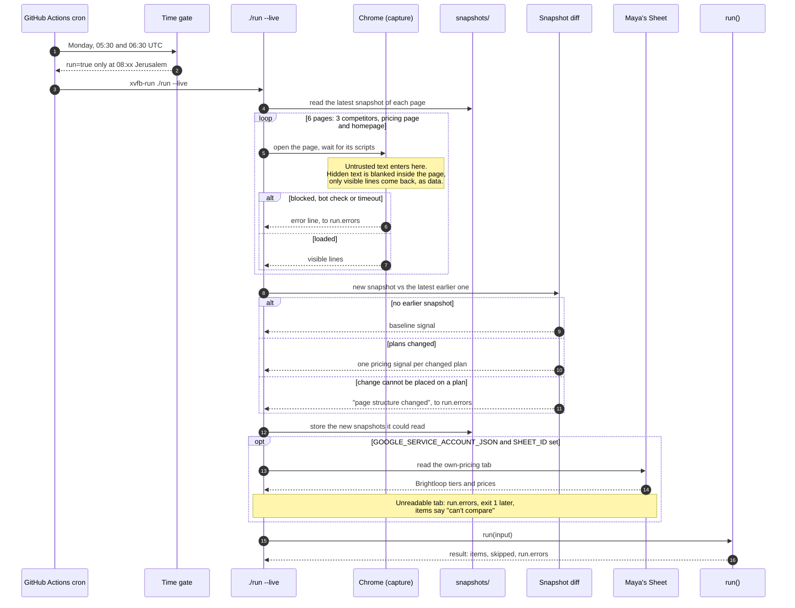
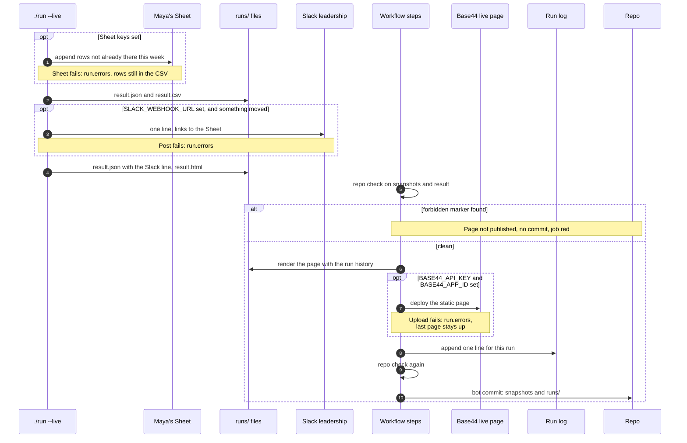
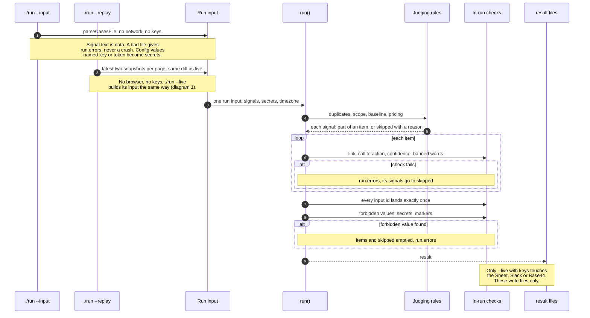

# Architecture: one run, from the Monday cron to Maya's Sheet

Three sequence diagrams, traced from the code (`src/cli.ts`, `src/run.ts`, `.github/workflows/scheduled-run.yml`), not from the spec. The first two are the Monday run, split where `./run` hands its result to the rest of the workflow. The third shows that a grader's cases file and a replay reach the same `run()`.

Names follow `CONTEXT.md`: a **snapshot** is one page's visible text from one run, a **signal** is one observed change, an **item** is a recommendation to Maya, a **skipped signal** is one that became no item, with the reason.

Rendered copies for slides and the recording: [part A](architecture-monday-capture.svg), [part B](architecture-monday-deliver.svg), [one pipeline](architecture-one-pipeline.svg). Regenerate them when a diagram changes.

How to read them: `opt` is a step that happens only when its keys are set; `alt` is a branch, and a red note is a failure that goes to `run.errors` instead of crashing. Without any key, every `opt` box is skipped and the run still writes its files.

---

## 1. Monday run, part A: capture the pages and judge them

**Read aloud:**

1. GitHub fires the workflow twice every Monday morning, because Israel changes clocks; a small time gate lets only the 08:30 Jerusalem one through.
2. The run opens six public pages in a real Chrome: the pricing page and homepage of Lovable, Replit and Bolt. Chrome is needed because Lovable's prices only appear after JavaScript runs.
3. This is where outside text enters the tool. Anything a person cannot see on the page is blanked before the text is read, and what is left is only ever data, never instructions.
4. Each page is compared with last week's snapshot. A first look is a baseline; a changed plan becomes a pricing signal; a change the tool cannot place on a plan becomes an error that says "check by hand", never a guessed number.
5. With the Sheet keys, Brightloop's own prices are read from Maya's own-pricing tab at run time. Without them, items say the comparison can't be made.
6. Everything then goes into one function, `run()`, the same one the graders run.

**Why this shape:**

- A scheduled GitHub Action instead of a server or Base44 backend functions: the graders must run the same logic from a fresh clone with zero keys (ADR 0002).
- A real browser and a line diff instead of an LLM reading the page: no cost, nothing a hidden instruction can talk to, and the zero-key hidden tests still pass (ADR 0003).
- Page text is data, and hidden text is stripped before anything reads it: the brief itself plants hidden instructions (ADR 0001).
- Two cron lines and a gate: GitHub schedules are UTC only, and the clocks change on 25 October (DECISIONS, 2026-10-23, scheduled run).
- A page the tool can't read gives no snapshot, so next week compares against the last good one (DECISIONS, 2026-10-23, page structure changed).
- Own prices come from Maya's Sheet at run time, never from the code (DECISIONS, 2026-10-22, own prices).

---

## 2. Monday run, part B: deliver the result and record the run

**Read aloud:**

1. With the Sheet keys, the run appends one row per change to Maya's Sheet. A re-run in the same week skips rows that are already there.
2. `result.json` and a CSV with the same rows are written first, before anything is posted, so a posted line is never left unstored.
3. With the Slack key, one line goes to leadership. A quiet week is stored but not posted: Maya said leadership doesn't need a "nothing happened" ping.
4. Before anything goes public, a repo check scans the snapshots and the result for the brief's forbidden markers. If it finds one, nothing is published and nothing is committed.
5. Then the live page is rendered with the run history and, with the Base44 keys, deployed to the Base44 app as a static page.
6. Every failure on the way, Sheet, Slack or Base44, lands in `run.errors` and in the run log line. Nothing crashes the run, but a Sheet failure turns the job red.
7. Last, the bot commits the new snapshots, the result and the run log, so next week has something to compare against, and every run is a recorded run the graders can replay.

**Why this shape:**

- Every surface is optional and named by its keys: a fresh clone with no keys still writes `result.json`, the CSV and the page (SPEC, Zero keys; ADR 0002).
- Each step gets only its own keys, in the workflow and in `scripts/local-run.sh` (DECISIONS, 2026-10-23, local dev run).
- Failures go to `run.errors`, never into items and never a crash (ADR 0001; DECISIONS, 2026-10-23, in-run checks).
- Repo check before the page goes up, and again before the commit: the page is public (DECISIONS, 2026-10-23, review of the live page).
- A static page deployed each run, not a Base44 page reading entities: one source of truth, the committed result (DECISIONS, 2026-10-23, live page #12).
- No Slack ping on a quiet week, and the tool never says "respond now", only "your call before 11:00" (DECISIONS, 2026-10-24).
- Committed snapshots double as the replay fixtures (SPEC, Stages 2).

---

## 3. One pipeline, two sources: every way in reaches the same run()

**Read aloud:**

1. There is one entry point, `./run`, and three ways to feed it: a cases file, stored snapshots, or the live web.
2. The graders' path is `./run --input cases.json --output result.json`. It needs no keys and makes no network call, and it writes `result.json`, `result.csv` and `result.html`.
3. A replay reads the two latest stored snapshots of each page and diffs them exactly like the live run, without opening a browser.
4. All three become the same run input and go through the same `run()`: no second copy of the logic for tests.
5. Inside `run()`, an ordered list of plain rules decides each signal: duplicates first, then scope, baseline and pricing.
6. Code then checks every output before it is written. An item that fails is held back with the reason, every input id must land exactly once, and a secret or forbidden marker empties the output rather than leak.

**Why this shape:**

- One `run()` for every source, so the hidden tests prove the live app's logic (SPEC, One pipeline, two sources; ADR 0002).
- Rules, not an LLM, so unseen cases work with zero keys and `cost_usd` is 0 (ADR 0003).
- Code validates every output; a failure is a run error, not an item (ADR 0001).
- Judging is an ordered list of rules, duplicates first (DECISIONS, 2026-10-23, `RULES` and `mergeDuplicates`).
- Config values whose name says key, token, secret or password are treated as secrets and never written (DECISIONS, 2026-10-23, secrets).
- Replay is the live diff on stored snapshots, so the recorded real runs are part of the proof (DECISIONS, 2026-10-23, replay).

---

## Where keys are needed, and what happens without them

| Key | Step | Without it |
|---|---|---|
| none | `./run --input`, `./run --replay`, the proof | Always works: `result.json`, `result.csv`, `result.html` |
| Chrome installed | `./run --live` capture | "could not start Google Chrome", in `run.errors` |
| `GOOGLE_SERVICE_ACCOUNT_JSON` and `SHEET_ID` | read own pricing, append rows | Rows in the CSV only, items say "can't compare" |
| `SLACK_WEBHOOK_URL` | post the line | Line stored, status `not posted: no SLACK_WEBHOOK_URL` |
| `BASE44_API_KEY` and `BASE44_APP_ID` | publish the page | Page written to `runs/result.html` only |

## Where outside text enters, and how it stays data

| Entry | Guard | Code |
|---|---|---|
| Competitor pages | Hidden text blanked inside the page, bot-check pages never stored | `src/capture/visible-lines.ts`, `src/capture/capture-pages.ts` |
| Cases file | Errors name a position, never the raw id, credential values become secrets | `src/input/parse-cases-file.ts` |
| Signal source | Trust read from visible text only, comments and tags dropped | `src/judging/source-trust.ts` |
| Every output | In-run checks, forbidden values empty the result | `src/checks/index.ts`, `src/run.ts` |
| Before publish and commit | Repo check for the brief's markers | `scripts/repo-check.ts`, `.github/workflows/scheduled-run.yml` |
